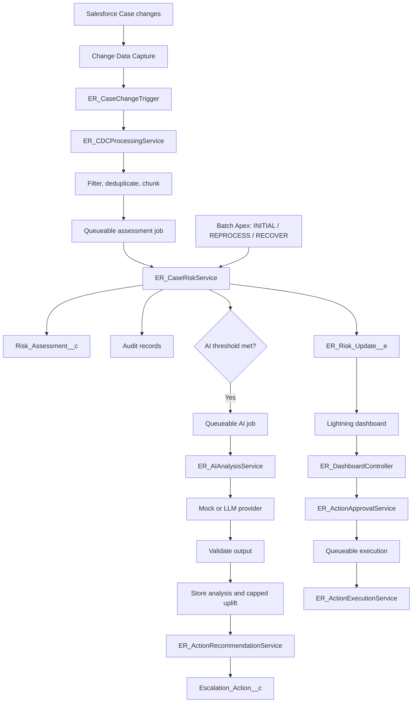
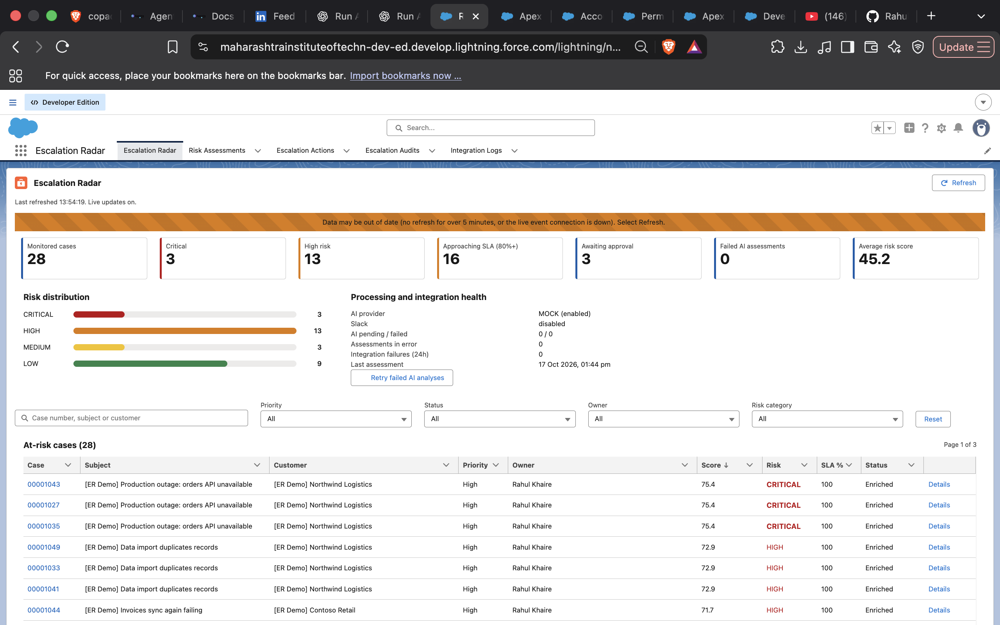
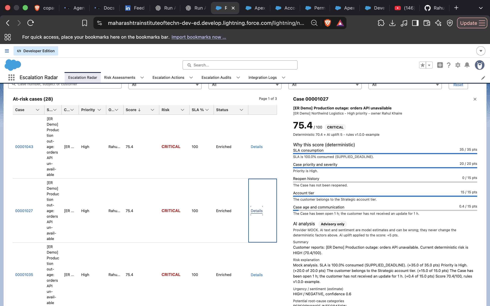
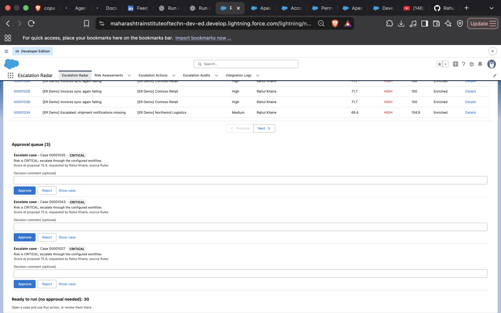

<div align="center">

# 🚨 Escalation Radar

### See the risk. Understand the reason. Approve the response.

**An AI-assisted support-leadership command center for Salesforce.**

Monitor Case changes, calculate explainable SLA-breach risk, enrich selected assessments with validated AI analysis, and manage controlled actions from a Lightning dashboard—with an audit trail for important decisions.

<br/>


**Project status:** source and documentation prepared; deployment and runtime verification are still pending.

[Architecture](#-architecture) · [Features](#-key-features) · [Setup](#-quick-start) · [Demo](#-demo-workflow) · [Implementation Status](#-implementation-status)

</div>

---

> [!IMPORTANT]
> **Read before demoing:** The project has been statically checked, but it has **not yet been deployed to a Salesforce org, compiled by the Apex compiler, or test-run**. It was produced in an environment without Salesforce CLI or org access. Review [`docs/IMPLEMENTATION_STATUS.md`](docs/IMPLEMENTATION_STATUS.md), then run [`scripts/validate.sh`](scripts/validate.sh) against a development org before relying on the implementation. Do not describe it as production-ready or tested until runtime validation succeeds.

## 📌 Table of contents

- [What is Escalation Radar?](#-what-is-escalation-radar)
- [The problem it addresses](#-the-problem-it-addresses)
- [Key features](#-key-features)
- [Architecture](#-architecture)
- [Risk scoring](#-risk-scoring)
- [AI enrichment and guardrails](#-ai-enrichment-and-guardrails)
- [Action approval workflow](#-action-approval-workflow)
- [Dashboard experience](#-dashboard-experience)
- [Technology stack](#-technology-stack)
- [Repository structure](#-repository-structure)
- [Quick start](#-quick-start)
- [Demo workflow](#-demo-workflow)
- [Configuration and integrations](#-configuration-and-integrations)
- [Security considerations](#-security-considerations)
- [Testing](#-testing)
- [Screenshots](#-screenshots)
- [Implementation status and limitations](#-implementation-status-and-limitations)
- [Troubleshooting](#-troubleshooting)
- [Contributing](#-contributing)
- [License](#-license)
- [Author](#-author)

---

## 🎯 What is Escalation Radar?

Escalation Radar is a Salesforce support-operations project designed to help managers identify Cases that may need attention before a service-level agreement (SLA) is breached or a customer issue escalates.

It combines a **deterministic risk engine** with optional AI-assisted context analysis. The deterministic engine calculates the baseline score and explains its contributing factors. AI analysis can add limited context, but it cannot directly execute actions. Managers can review proposed actions and approve or reject actions that require approval.

### The core idea

| Without an early-warning workflow | With Escalation Radar |
|---|---|
| Risk may be noticed only after a complaint or missed SLA | Cases can be prioritised using configured risk signals |
| A score may be difficult to explain | Factor points and the rule version can be recorded |
| AI suggestions can be hard to control | AI output is validated and actions are allowlisted |
| Decisions can be difficult to trace | Important assessment and action steps are audited |

Escalation Radar is intended as a **decision-support tool for support teams**, not as an unrestricted autonomous agent.

## 🧩 The problem it addresses

Support teams handle Cases with different urgency, customer impact, age, and communication history. As Case volume grows, manually finding the most at-risk records becomes harder.

Escalation Radar is designed around five steps:

1. **Detect** relevant Case changes through Change Data Capture (CDC).
2. **Assess** risk with deterministic, configurable rules.
3. **Explain** the score through per-factor contributions.
4. **Recommend** a limited set of predefined actions.
5. **Control and audit** approvals, execution, and important decisions.

---

## ✨ Key features

### 📊 Explainable risk scoring

- Produces a risk score from **0 to 100**.
- Uses configured signals for SLA, priority, reopen count, account tier, Case age, and communication.
- Stores per-factor points and the rule version used for an assessment.
- Keeps weights, thresholds, SLA policy, and factor mappings in **Custom Metadata Types**.
- Uses deterministic rules as the baseline; AI is optional enrichment rather than the source of the core score.

### ⚡ Event-driven Case processing

- Starts from the `CaseChangeEvent` CDC event.
- Routes events through `ER_CaseChangeTrigger` and `ER_CDCProcessingService`.
- Filters irrelevant events, deduplicates by commit number, and chunks work into bounded Queueable jobs.
- Includes Batch Apex paths for initial assessment, reprocessing, and recovery.
- Publishes `ER_Risk_Update__e` after commit to support dashboard refreshes.

### 🧠 Optional AI enrichment

- Uses an AI provider interface rather than coupling the service to one provider.
- Includes a **Mock provider** for demos without external credentials.
- Includes an LLM provider configured through Salesforce Named Credentials.
- Validates response structure before accepting provider output.
- Documents PII redaction, prompt-injection containment, retries with backoff, and deterministic fallback.
- Limits AI's contribution to a small, capped score uplift.
- Prevents AI analysis from directly executing actions.

### 🛡️ Allowlisted action framework

- Offers six predefined action types.
- Separates **propose → approve/reject → execute**.
- Requires approval for reassignment and Slack actions.
- Revalidates conditions before execution.
- Includes replay and duplicate protection.
- Records important action lifecycle events.

### 🔔 Live dashboard updates

- Uses the `ER_Risk_Update__e` Platform Event.
- The LWC dashboard subscribes through `lightning/empApi`.
- Stale-data and recovery behaviour are documented.

### 🧾 Audit and operational visibility

- Application-level audit trail.
- Integration logging.
- Health panel and recovery-oriented behaviour.
- Permission sets for access control.
- Optional Slack adapter, disabled by default, with a mock option available.

### ♿ Dashboard UX

- KPI cards and risk distribution.
- Search, filters, sorting, and pagination.
- Case detail and factor breakdown.
- AI analysis and action recommendation panels.
- Approval queue and audit history.
- Health panel.
- Loading, empty, error, and stale-data states.
- Keyboard-accessible interactions are part of the documented UI.

---

## 🏗️ Architecture



### Main processing stages

| Stage | Responsibility |
|---|---|
| CDC trigger and processing service | Filter, deduplicate, and schedule relevant Case changes |
| Risk service | Calculate baseline score and store assessment details |
| AI analysis service | Optionally enrich an assessment through a configured provider |
| Recommendation service | Create a predefined action recommendation |
| Approval service | Handle manager approval or rejection |
| Execution service | Revalidate and execute an approved action |
| Platform Event | Notify subscribers that committed risk data changed |
| Batch Apex | Support initial assessment, reprocessing, and recovery |

For implementation-specific details, see [`docs/ARCHITECTURE.md`](docs/ARCHITECTURE.md).

---

## 🎚️ Risk scoring

Escalation Radar is designed to calculate a deterministic baseline score between **0 and 100**.

| Signal | Why it matters |
|---|---|
| SLA | Highlights Cases approaching or at risk of breaching a service target |
| Priority | Reflects configured urgency |
| Reopen count | Captures repeated reopening as a potential warning signal |
| Account tier | Applies configured account or service-policy importance |
| Case age | Highlights long-running Cases |
| Communication | Represents the configured communication-related signal |

The score is intended to be explainable: each assessment stores factor points and the rule version used. Weights, thresholds, SLA policy, and mappings are configured through Custom Metadata Types.

> [!NOTE]
> The project description refers to “five weighted factors” but lists six signal categories. The exact number of configured factors and their numeric weights must be confirmed from the repository's Custom Metadata and implementation. This README does not invent point values or thresholds.

## 🧠 AI enrichment and guardrails

AI is **optional** and is kept separate from the deterministic scoring engine.

| Provider | Intended use |
|---|---|
| Mock provider | Local development and demonstrations without an API key |
| LLM provider | External model calls configured using Salesforce Named Credentials |

Documented safeguards include:

- Redacting configured PII before sending content to a provider.
- Treating Case comments and model responses as untrusted input.
- Containing prompt-injection attempts.
- Validating the response against a strict schema.
- Retrying eligible failures with backoff.
- Falling back to deterministic behaviour when AI output is unavailable or invalid.
- Capping the AI score uplift.
- Preventing the AI provider from directly executing actions.

These safeguards still require code review and runtime tests. Do not send real customer data to an external provider until data handling, credentials, permissions, and organisational policies have been reviewed.

## ✅ Action approval workflow

The action framework is designed to keep recommendations controlled and traceable.

```text
Risk assessment
      ↓
Action recommendation
      ↓
Manager review (where required)
   ↙             ↘
Reject           Approve
                   ↓
          Revalidate the action
                   ↓
          Execute through allowlist
                   ↓
              Audit result
```

The implementation describes six allowlisted action types. Reassignment and Slack actions require approval. Approval is not a substitute for execution-time validation: the system is designed to revalidate conditions and protect against duplicate or replayed execution.

Review the actual allowlist, permissions, and execution service before enabling integrations or using the system with live Cases.

## 🖥️ Dashboard experience

The main LWC is `escalationRadarDashboard`, with 10 child components.

| Dashboard area | Intended capability |
|---|---|
| Overview | KPI cards and risk distribution |
| Case discovery | Search, filters, sorting, pagination |
| Case detail | Score and per-factor explanation |
| AI panel | Validated AI analysis when enabled |
| Action panel | Recommended actions and status |
| Approval queue | Manager approval/rejection workflow |
| Audit history | Recorded events and decisions |
| Health panel | Operational health and stale-data visibility |
| UX states | Loading, empty, error, and stale-data handling |

The dashboard has not yet been run in a Salesforce org. Treat this as the documented UI scope until deployment and interaction testing confirm the behaviour.

---

## 🧰 Technology stack

| Layer | Technology |
|---|---|
| Platform | Salesforce DX, API version 62.0 |
| Backend | Apex, triggers, Queueable Apex, Batch Apex, Schedulable Apex |
| Frontend | Lightning Web Components |
| Eventing | Change Data Capture, Platform Events |
| Configuration | Custom Metadata Types |
| Integrations | Named Credentials, External Credentials, optional Slack adapter |
| Data access | User-mode SOQL and DML |
| Live updates | `lightning/empApi` |
| Tooling | Salesforce CLI (`sf`), Git |
| Client dependencies | No third-party JavaScript libraries |

## 📁 Repository structure

The following is an illustrative structure based on the documented components. Confirm exact paths against the actual repository.

```text
escalation-radar/
├── force-app/
│   └── main/default/
│       ├── classes/
│       ├── triggers/
│       ├── lwc/
│       ├── objects/
│       ├── customMetadata/
│       ├── permissionsets/
│       └── platformEvents/
├── scripts/
│   ├── validate.sh
│   ├── deploy.sh
│   └── seed-demo-data.apex
├── docs/
│   ├── IMPLEMENTATION_STATUS.md
│   ├── ARCHITECTURE.md
│   ├── SETUP_GUIDE.md
│   └── DEMO_GUIDE.md
├── sfdx-project.json
└── README.md
```

---

## 🚀 Quick start

> Use a **development org**, not production, for initial validation. Review each script before executing it.

### 1. Prerequisites

- Salesforce CLI installed.
- A Salesforce Developer Edition org or another suitable development org.
- Permission to deploy the project's Apex, LWC, objects, metadata, Platform Events, and permission sets.
- Git installed if cloning the repository.
- External credentials only if testing an external LLM or Slack integration.

Check the CLI:

```bash
sf --version
```

### 2. Authenticate

```bash
sf org login web \
  --alias escalation-radar-dev \
  --instance-url https://login.salesforce.com
```

For a sandbox, use the appropriate sandbox login URL.

Verify the connection:

```bash
sf org display --target-org escalation-radar-dev
```

### 3. Read the setup and implementation notes

Before deployment, read:

- [`docs/IMPLEMENTATION_STATUS.md`](docs/IMPLEMENTATION_STATUS.md)
- [`docs/SETUP_GUIDE.md`](docs/SETUP_GUIDE.md)

### 4. Validate and deploy

Run the repository validation script:

```bash
scripts/validate.sh escalation-radar-dev
```

Then, after reviewing validation output and the deployment script:

```bash
scripts/deploy.sh escalation-radar-dev
```

The deploy script is documented as deploying the project and assigning `ER_Radar_Manager` to your user. Confirm the exact behaviour in the current script and inspect all command output.

### 5. Complete required manual configuration

Follow the setup guide for any applicable configuration, including:

- Change Data Capture settings and subscriber-user access.
- Named Credentials and External Credentials.
- Optional Slack webhook and adapter configuration.
- Recovery schedule.
- Permission sets and access.
- Any org-level configuration required by the project.

The default AI provider is documented as `MOCK`, so the basic demonstration should not require an external LLM credential. Confirm the actual configuration in your deployed org.

### 6. Seed demonstration data

After deployment and configuration:

```bash
sf apex run \
  --file scripts/seed-demo-data.apex \
  --target-org escalation-radar-dev
```

Review the script before running it, particularly if the org contains important data. A successful seed command does not prove that asynchronous risk, AI, event, or recommendation processing has completed.

### 7. Run Apex tests

```bash
sf apex run test \
  --target-org escalation-radar-dev \
  --test-level RunLocalTests \
  --wait 30
```

Review the actual test summary and resolve failures. If the test run has not completed within the wait period, retrieve its result using the Salesforce CLI commands available in your installed version.

### 8. Open the app

Open **Escalation Radar** from the Salesforce App Launcher. Confirm that the dashboard loads, the current user has the necessary permissions, and the seeded Cases appear as expected.

Full setup details: [`docs/SETUP_GUIDE.md`](docs/SETUP_GUIDE.md).

---

## 🎬 Demo workflow

See [`docs/DEMO_GUIDE.md`](docs/DEMO_GUIDE.md) for the intended five-minute demo, scenarios, and failure-recovery walkthrough.

Suggested sequence once the project is verified in an org:

1. Open the dashboard and explain the KPIs.
2. Find a seeded Case and open its detail view.
3. Explain the deterministic score using the factor breakdown.
4. Show mock AI enrichment if it is enabled and working.
5. Review an action recommendation and its approval requirement.
6. Approve or reject a suitable demo action.
7. Show the action result and related audit history.
8. Demonstrate how the dashboard signals stale data or a recoverable processing issue, if supported by the deployed build.

Do not claim that a step works until it has been exercised successfully in the target org.

## 🔌 Configuration and integrations

| Component | Configuration approach | Notes |
|---|---|---|
| Risk rules | Custom Metadata Types | Confirm actual weights, thresholds, and factor mappings |
| AI provider | Mock or LLM provider | Mock is intended for demos; LLM setup requires credentials |
| LLM authentication | Named Credentials / External Credentials | Configure and test separately |
| Slack | Optional adapter | Disabled by default; requires deliberate setup |
| CDC | Salesforce Change Data Capture | Verify event configuration and subscriber access |
| Recovery | Batch/scheduled processing | Follow the setup guide and verify job execution |
| Access control | Permission sets and user-mode data access | Review least-privilege access |

---

## 🔐 Security considerations

Before enabling the system beyond a test org:

- Never commit API keys, tokens, webhook URLs, passwords, or private credentials.
- Review `.gitignore` and scan the repository for secrets before pushing to GitHub.
- Use a dedicated development org for initial deployment and testing.
- Review permission sets, Named Credentials, External Credentials, and execution permissions.
- Treat Case comments and external model output as untrusted input.
- Verify PII redaction and data-handling requirements before sending customer data to an external LLM.
- Keep high-impact actions behind approval and test execution-time revalidation.
- Verify allowlist enforcement, duplicate protection, and replay protection.
- Restrict access to audit and integration logs appropriately.
- Remember that the documented audit trail is application-level and is **not tamper-evident**.

## 🧪 Testing

The project documentation describes **10 Apex test classes**, approximately **85 test methods**, and approximately **260 assertion calls**.

These figures describe the intended repository contents; they are **not evidence of passing tests**. At the time of writing:

- Apex has not been compiled in a Salesforce org.
- The Apex test suite has not been executed.
- Deployment and end-to-end dashboard behaviour have not been verified.

After running the tests, update this section with verified results. Record the org used, deployment outcome, test run ID, pass/fail counts, and any fixes required.

Recommended validation areas include:

- Deterministic risk scoring and metadata-driven rules.
- CDC filtering, deduplication, and bounded processing.
- Queueable and Batch Apex behaviour.
- AI response schema validation and deterministic fallback.
- Approval requirements and allowlisted action execution.
- Duplicate/replay protection and audit records.
- Permission and user-mode data access.
- Dashboard loading, error, and stale-data behaviour.


## 🖼️ Screenshots

### 📊 Dashboard Overview


### 🔍 Case Detail & Risk Breakdown


### ✅ Manager Approval Queue

s

## 🚧 Implementation status and limitations

| Area | Current documented status |
|---|---|
| Source and documentation | Prepared and statically checked |
| Apex compilation in an org | Not yet verified |
| Automated Apex tests | Not yet executed |
| Deployment | Not yet verified |
| Dashboard runtime | Not yet verified |
| External LLM integration | Requires configuration and testing |
| Slack integration | Optional; disabled by default |
| Business-hours SLA | Uses the org's default business hours only |
| Salesforce Flow | No Flow is shipped; an escalation action can invoke a Flow you configure |
| Audit integrity | Application-level, not tamper-evident |

The first deployment may reveal compilation, metadata, permissions, or runtime issues. Treat deployment as a validation phase, not a guaranteed one-click production installation.

For the full status and limitations, see [`docs/IMPLEMENTATION_STATUS.md`](docs/IMPLEMENTATION_STATUS.md).

## 🛠️ Troubleshooting

### Salesforce CLI is not installed

Install Salesforce CLI, open a new terminal, and verify:

```bash
sf --version
```

### The target org alias is not recognised

List connected orgs and confirm the alias:

```bash
sf org list
sf org display --target-org escalation-radar-dev
```

Authenticate again if necessary.

### Deployment fails

- Read the first meaningful compiler or metadata error in the CLI output.
- Check the API version and org permissions.
- Confirm required objects, fields, Custom Metadata, Platform Events, and dependencies are present.
- Follow `docs/SETUP_GUIDE.md`.
- Do not assume a deployment succeeded if the command exited with an error.

### Seed data appears but risk assessments do not

The seed script may finish before asynchronous work completes. Check Apex Jobs, debug logs, CDC configuration, and the project's documented recovery process. Confirm that the relevant Queueable or Batch jobs completed successfully.

### AI enrichment is missing

Confirm that the configured provider is `MOCK` or that the LLM credentials and endpoint are configured. Inspect integration logs and job failures. A missing AI result should not be interpreted as a verified successful fallback without checking the implementation and logs.

### Dashboard data does not refresh

Check that `ER_Risk_Update__e` is configured and published as expected, that the current user can access the relevant records, and that the LWC subscription is working. Review browser console errors and Salesforce debug logs.

---

## 🤝 Contributing

Contributions and review are welcome.

1. Create a feature branch.
2. Make a focused change.
3. Add or update tests for changed behaviour.
4. Run validation and relevant Apex tests in a Salesforce development org.
5. Update documentation and configuration instructions.
6. Open a pull request with a clear summary and the actual test results.

Please do not report tests as passing unless they have been run and verified.

## 📄 License

No license has been specified yet. Until a `LICENSE` file is added, do not assume the repository grants permission to reuse, modify, or redistribute the code.

## 👨‍💻 Author

**Rahul Khaire**  
Salesforce Developer · AI & Data Science

---

<div align="center">

**Escalation Radar — explainable risk signals, controlled actions, accountable decisions.**

</div>
