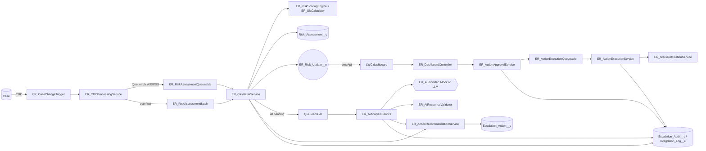

# Architecture

## Components

## Data flow and transaction boundaries

1. **User transaction** - a Case changes. `ER_CaseTrigger` (before update) only maintains `ER_Reopen_Count__c`. No callouts, no assessment work.
2. **CDC delivery** (separate async transaction, Automated Process or configured user) - `ER_CaseChangeTrigger` -> `ER_CDCProcessingService.processEvents`:
   header parsed; `UPDATE` events kept only if a risk field changed (`Priority, Status, OwnerId, AccountId, IsEscalated, ER_SLA_Deadline__c, ER_Reopen_Count__c`); `CREATE/DELETE/UNDELETE/GAP_*` always kept;
   per-Case max commit number; Cases whose `Last_Commit_Number__c` is already >= the event commit are dropped (**duplicate / replay protection**); work split into Queueables of 100 Cases (max 20 per transaction),
   overflow goes to a Batch; `GAP_OVERFLOW` starts a full reprocess batch. Success sets the **resume checkpoint**; transient failure throws `EventBus.RetryableException` (bounded); after the limit it logs an Integration Log with the affected Case Ids and moves on.
3. **ASSESS Queueable** (queries + DML, no callouts) - `ER_CaseRiskService.assessCases`: loads Cases, existing assessments, last public comment (aggregate), computes SLA and score, **upserts by `Case_Id__c`** (partial success), writes audit, publishes events for changed assessments, proposes actions for assessments that are final (no AI needed), and returns AI candidates.
4. **AI Queueable** (`Database.AllowsCallouts`) - `ER_AIAnalysisService.analyze`, strictly **SOQL -> callouts -> DML**: up to 5 Cases per job, remainder chained if the platform allows (otherwise they stay `AI_Pending` for the recovery batch). Results: validate, cap uplift, set status, audit, integration log, publish event, then propose actions.
5. **Approval** (user transaction) - `ER_ActionApprovalService.decide`: custom permission, row lock, state check, Case access (user mode), separation of duties, update, audit, enqueue execution.
6. **Execution Queueable** - `ER_ActionExecutionService.execute`: row lock (held across the optional Slack callout), duplicate guard, **revalidation**, execute (user-mode DML for customer data), record outcome, audit.

## Event processing and recovery

* CDC and Platform Events are **at-least-once**, not exactly-once, and not globally ordered; consumers are idempotent (upsert by external id, commit-number guard, action de-duplication).
* Dashboard events are hints; the LWC debounces and refetches current state. If an event is missed, **Refresh** or the next event fixes the view; a banner appears after 5 minutes without refresh or if the subscription errors.
* Missed or failed server-side work: `ER_RiskAssessmentBatch` modes INITIAL (no assessment yet), REPROCESS (all open Cases), RECOVER (Error, or AI_Pending whose retry time passed). The schedulable runs RECOVER.

## AI integration

Provider interface `ER_AIProvider`; `ER_MockAIProvider` (deterministic keywords) and `ER_LLMProvider` (Named Credential HTTP). Inputs are minimised (priority, tier, score, redacted subject/description/up to 3 public comments, no customer names) and truncated.
Output must pass `ER_AIResponseValidator`; invalid output = AI failure (no retry); the deterministic result always stands. AI effects: stored advisory text, a **capped uplift** (default max 5 points, only if confidence >= 0.5; HIGH urgency = full cap, MEDIUM = half) and **proposed allowlisted action ids** (unknown ids dropped).

## Approval workflow

Propose (`ER_ActionRecommendationService`, never executes) -> Pending/Not_Required -> manager approves/rejects -> execution revalidated. Approval is **always** required for `REASSIGN_CASE` and `SEND_SLACK_ALERT`, and for any types listed in `Approval_Required_Actions__c` (default `ESCALATE_CASE`).
Actions without approval are run explicitly by a user with `ER_Execute_Actions` (no auto-execution is implemented).

## Security boundaries

| Context | Operations |
|---|---|
| **User mode** (`WITH USER_MODE`, `AccessLevel.USER_MODE`, `as user`) | all dashboard reads; Case visibility checks in approval/execution; Case/CaseComment/Task changes made by actions |
| **System mode** (`without sharing`, justified) | CDC/Queueable/Batch assessment (must cover all Cases regardless of user); writes to the app's own objects (assessments, actions, audit, logs); platform event publishing; privileged requeue helper after a permission check |

## Retry and idempotency

* Assessment: upsert by `Case_Id__c`; commit-number guard; unchanged results do not publish events; AI cooldown (5 min) avoids repeated AI calls after our own changes.
* AI retries: retryable errors (timeout, 429, 5xx) -> `AI_Pending` with `Next_Retry_At__c` = now + 5 min x 2^(attempt-1); max attempts = `Max_Retries__c` (3), then `AI_Failed`. Validation/4xx errors fail immediately.
* Actions: one open/recent action per Case+type (24h cooldown after execution or rejection unless the risk category rose); `FOR UPDATE` row lock and `Execution_Status__c` compare before executing; approval replay rejected.
